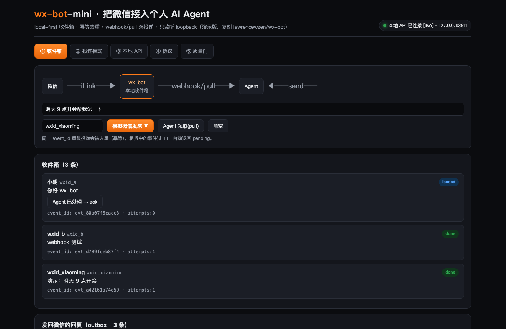
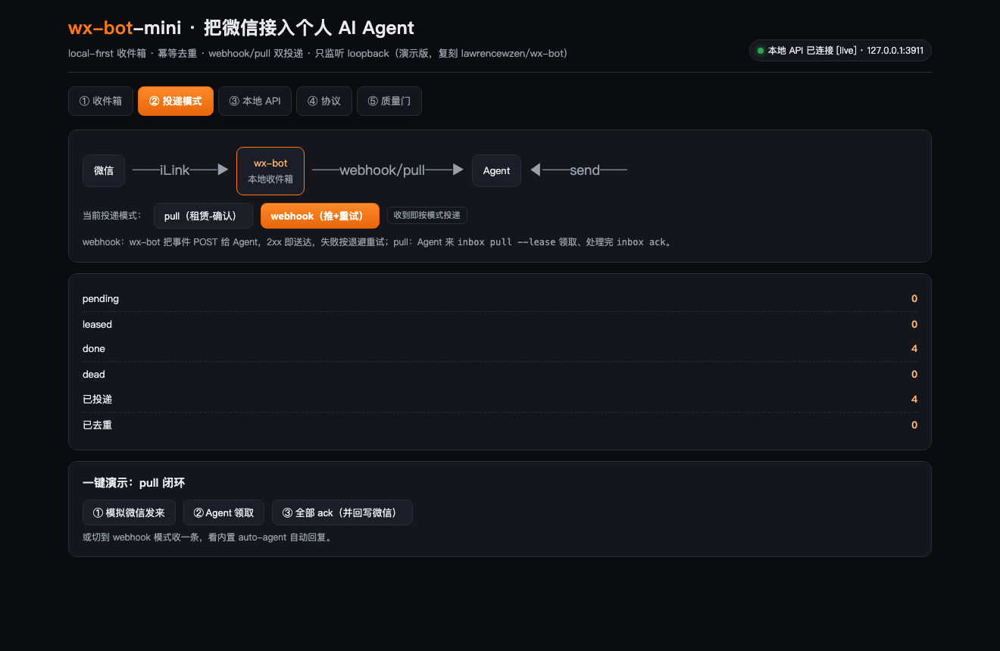
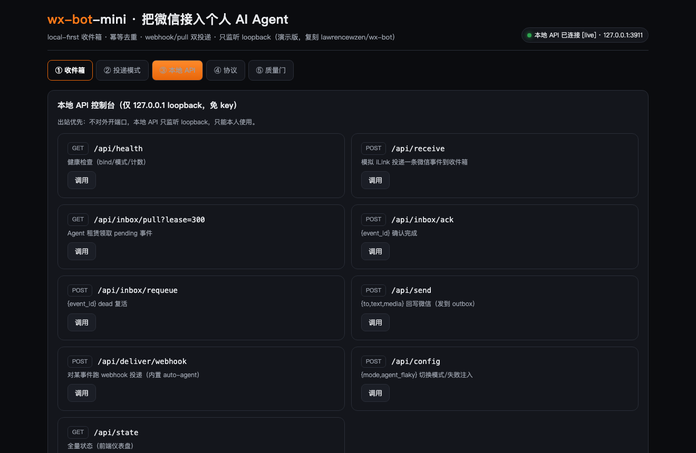
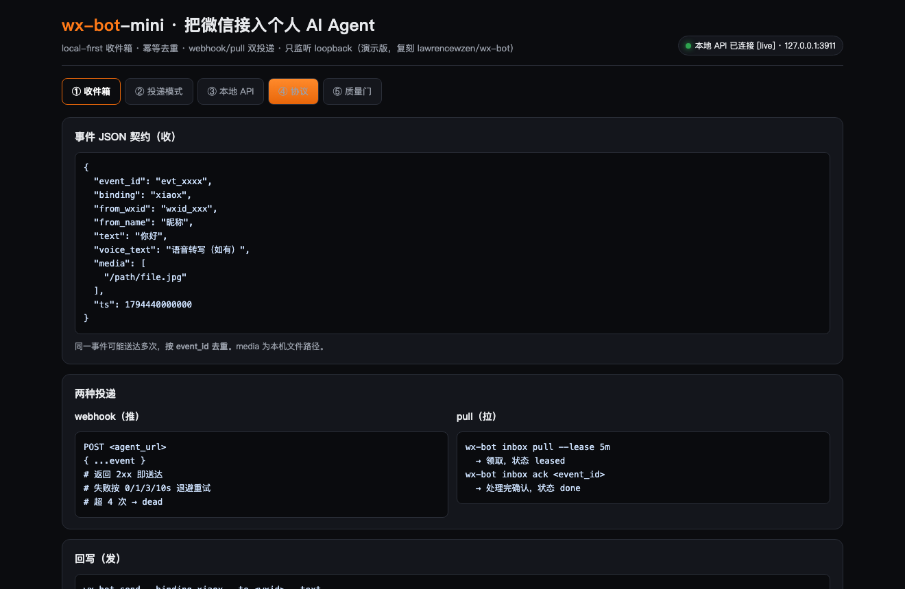
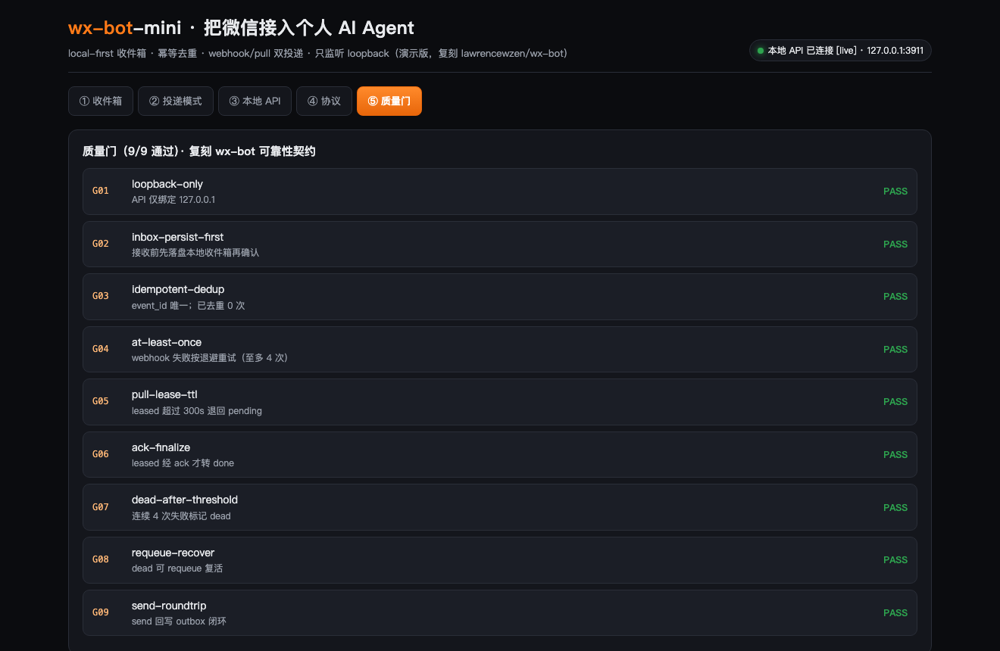

# wx-bot-mini

> 把**微信**接入你的个人 AI Agent（Grok / Muse / Claude 等）的最小可跑通演示。
> 上游完整版：[lawrencewzen/wx-bot](https://github.com/lawrencewzen/wx-bot)（TypeScript + Bun，220★，MIT）。
> **本仓库是结构演示版**：不接真实 iLink、不调真实大模型，所有动作确定性可复现，用来讲清「local-first 收件箱 + 双投递 + 幂等去重」这套可靠性架构。正式生产请用上游仓库。

## 它解决什么

你想让 Agent 替你管微信，但有两个硬约束：① **不能丢消息**（实时流，任何抖动都不能错过一条）；② **不能把本地端口暴露公网**（Agent 在云上，微信走腾讯官方通道，本地只该出站）。

wx-bot 的解法（本 demo 复刻的核心）：

```
WeChat ──iLink──▶ wx-bot(inbox) ──webhook / pull──▶ Agent
       ◀─────────────────────────── wx-bot send ────┘
```

- **先落盘，再确认**：消息进本地收件箱后才向 iLink 回 ACK → 不丢。
- **幂等去重**：同一 `event_id` 可能重复投递，按 id 去重，避免重复处理。
- **两种投递**：`webhook`（推，失败退避重试）/ `pull`（Agent 租赁-确认）。
- **只出站**：本地 API 仅监听 `127.0.0.1`，不开公网端口，只能本人使用。

## 操作截图（真实运行）

| ① 收件箱 · live 模式 | ② 投递模式 |
| --- | --- |
|  |  |

| ③ 本地 API 控制台 | ④ 协议 | ⑤ 质量门 |
| --- | --- | --- |
|  |  |  |

> 前端自动检测本地 API：连上显示 `[live]`（真实请求 127.0.0.1:3911）；未连则降级内置 JS 引擎 `[mock]`，离线也能完整体验。

## 本地跑

```bash
# 1) 启动本地 API（单端口同时提供静态页 + API，仅 127.0.0.1）
python3 server.py 3911
# 浏览器打开 http://127.0.0.1:3911/index.html

# 2) 另开终端，跑 headless 场景（落 output/*.json + 打印质量门）
python3 pipeline.py
# => 接收 4 条 / 幂等去重 1 / 成功投递 3 / 回写微信 3 / 质量门 9/9 通过
```

零依赖（仅 Python 标准库）。`index.html` 也能单独双击打开（走 `[mock]` 内置引擎）。

## 核心文件

| 文件 | 作用 |
| --- | --- |
| `core.py` | 本地收件箱内核：落盘优先 / `event_id` 去重 / webhook 重试 / pull 租赁-确认 / send 回写 / 9 道质量门（纯标准库） |
| `server.py` | `127.0.0.1` loopback 本地 API（REST）+ 静态文件服务，免 key；含模拟 iLink 注入与内置 auto-agent |
| `pipeline.py` | headless 跑「微信→收件箱→双投递→Agent 回复→回写」场景，落盘 JSON + 质量门报告 |
| `index.html` | 交互式前端：5 个 Tab（收件箱 / 投递模式 / 本地 API / 协议 / 质量门），live↔mock 自动降级 |
| `SKILLS.md` | 能力说明书（收 / 投递 / 回 + 质量门契约） |
| `samples/` | 配置示例 |

## 质量门（可靠性契约）

`python3 pipeline.py` 跑完会校验 9 道门，全部通过：

`G01 loopback-only` · `G02 inbox-persist-first` · `G03 idempotent-dedup` · `G04 at-least-once` · `G05 pull-lease-ttl` · `G06 ack-finalize` · `G07 dead-after-threshold` · `G08 requeue-recover` · `G09 send-roundtrip`

## 与上游的差异（务必看清）

| 维度 | 上游 lawrencewzen/wx-bot | 本 mini 演示 |
| --- | --- | --- |
| 语言 | TypeScript + Bun | Python 标准库 |
| 微信通道 | 真实腾讯官方 ClawBot / iLink | 模拟（无真实消息） |
| Agent | 真实大模型 / webhook | 内置 auto-agent（确定性回显） |
| 存储 | SQLite | JSON 文件 |
| 部署 | systemd / launchd / Docker / Cloudflare | 单机 `python3 server.py` |
| 目的 | 生产可用 | **讲清架构，教学演示** |

## License

MIT（demo 部分 © clawgeek；上游 © lawrencewzen）。
